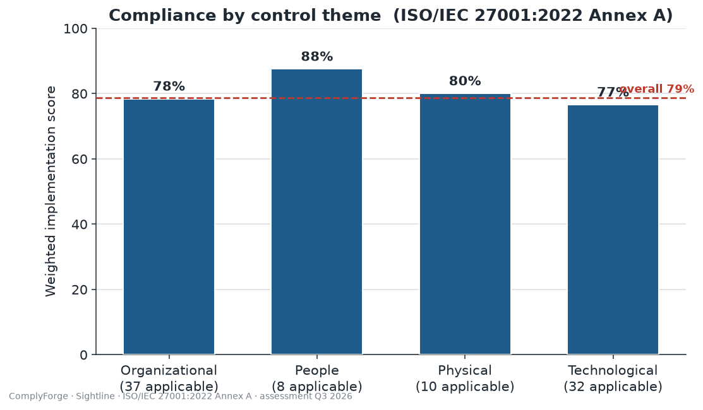
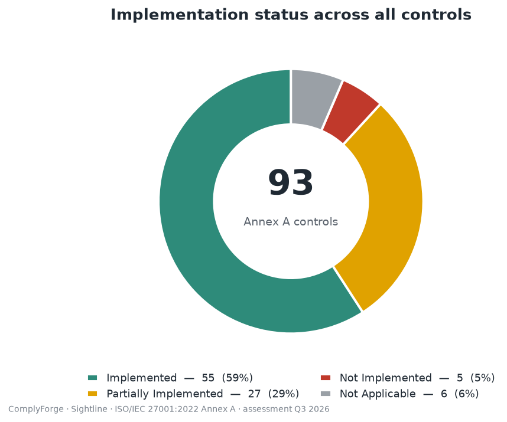
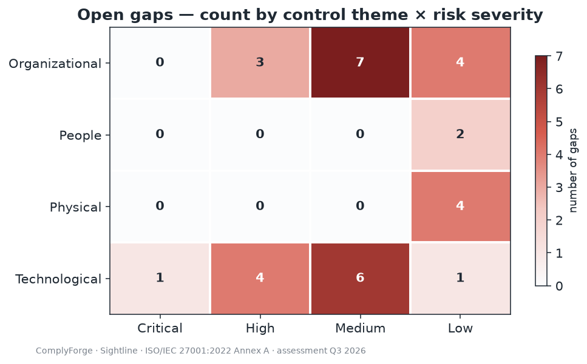
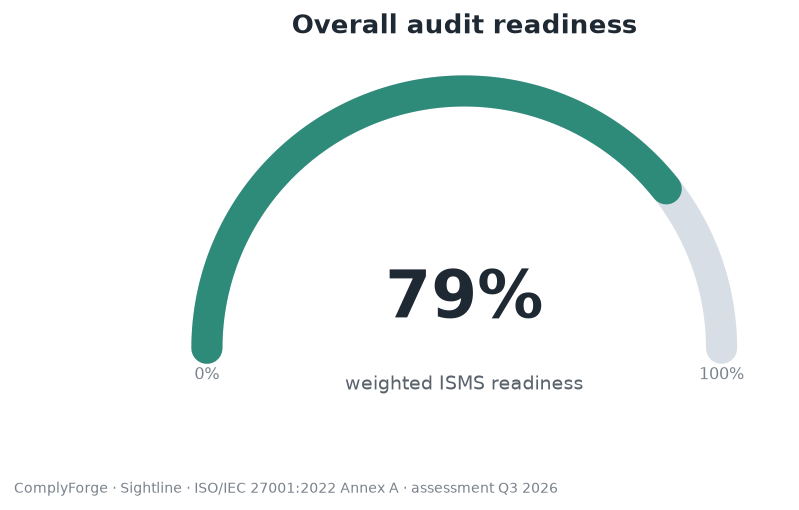
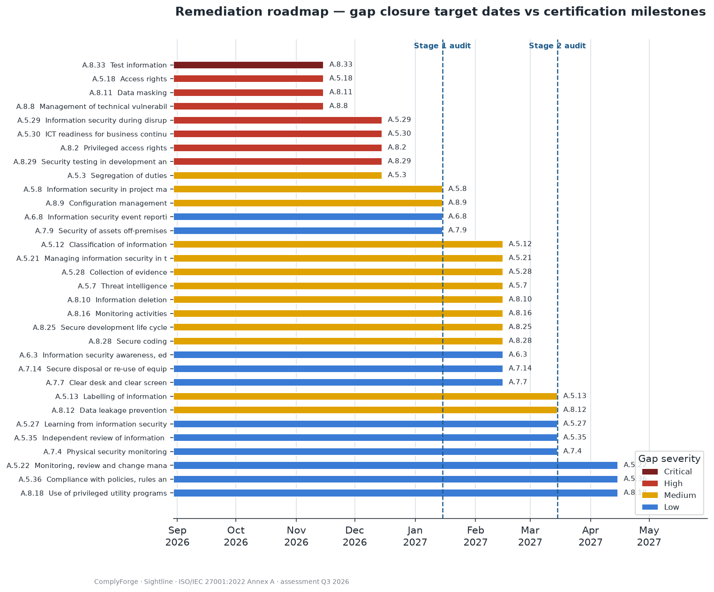

<h1 align="center">ComplyForge</h1>

<p align="center">
  <b>An audit-ready ISO/IEC 27001:2022 control assessment & evidence package for a fictional cloud SaaS.</b><br/>
  <i>The tangible proof of GRC / audit-lead competency — not just "familiar with ISO 27001".</i>
</p>

<p align="center">
  
  
  
  
  
  
</p>

---

## What this is

Almost every security-compliance and GRC role describes the same core duty: **produce
the documentation and evidence that demonstrates an organization meets a control
framework, coordinate that evidence toward certification, and author parts of a System
Security Plan.** Candidates rarely have a tangible artifact proving they can do it.

**ComplyForge is that artifact.** It is a complete, realistic audit-evidence package
for a fictional B2B SaaS — built the way an audit lead actually builds one. It runs
the full loop: **map the controls → assess implementation → attach evidence → find the
gaps → rate the risk → plan remediation → report readiness.**

> Everything is anchored to one coherent fictional system (**Sightline**, by
> **Harborline Technologies**) so the package reads as a single engagement, not a pile
> of generic templates. The **framework is real**; the company, statuses, evidence, and
> gaps are **synthetic and realistic**. See the [methodology](docs/methodology.md).

## Headline results

<p align="center">
  
</p>

| Metric | Result |
|---|---|
| Annex A controls assessed | **93** (87 applicable, 6 Not Applicable with justification) |
| Weighted compliance score | **78.7%** |
| Fully implemented | 55 (63% of applicable) · Partial 27 · Not implemented 5 |
| Open gaps | **32** — 1 Critical, 7 High, 13 Medium, 11 Low |
| Certification target | ISO 27001 Stage 1 Jan 2027 · Stage 2 Mar 2027 |

*(All numbers are generated from a single dataset — they cannot drift between the
workbook, charts, and report.)*

## What's in the package

| Deliverable | File | What it demonstrates |
|---|---|---|
| 🧮 **Control Assessment Workbook** *(centerpiece)* | [`control_assessment_workbook.xlsx`](control_assessment_workbook.xlsx) | All 93 controls with status, owner, evidence, gap, remediation, risk & NIST crosswalk; plus SoA, summary charts, and a ranked gap register. |
| 📋 **Evidence Collection Tracker** | [`evidence_tracker.xlsx`](evidence_tracker.xlsx) | 87 evidence items mapped to controls, owners, and collection/submission status — the audit-lead coordination artifact. |
| 📄 **Sample SSP Section** | [`ssp/sample_ssp_section.md`](ssp/sample_ssp_section.md) | System characterization, authorization boundary, and full control-implementation narratives (NIST 800-18 / FedRAMP style). |
| 📊 **Audit Readiness Report** | [`reports/audit_readiness_report.md`](reports/audit_readiness_report.md) | Executive-facing posture, top gaps by risk, and a remediation roadmap. |
| 🏗️ **System Profile** | [`data/system_profile.md`](data/system_profile.md) | The fictional SaaS: architecture & data-flow diagrams, data sensitivity, shared-responsibility split. |
| 🧭 **Methodology** | [`docs/methodology.md`](docs/methodology.md) | Framework versions, scope, rating scales, scoring math, applicability decisions. |

## The figures

| | | |
|---|---|---|
|  |  |  |
| Status breakdown | Gap severity heatmap | Readiness gauge |

<p align="center"></p>

## The fictional system in one paragraph

**Sightline** is a multi-tenant B2B SaaS that gives mid-market logistics operators
real-time supply-chain visibility and machine-learning predictive ETAs. It runs on AWS
(EKS, RDS, S3, MSK), handles customer and **driver PII plus GPS/location data**, uses
SSO + phishing-resistant MFA, and is pursuing ISO 27001 to unlock enterprise and
public-sector deals. Its ML-driven ETA engine (and the location data it processes)
makes it a modern, realistic subject — and a forward path toward **ISO/IEC 42001** (AI
management). Full detail and architecture diagrams: [`data/system_profile.md`](data/system_profile.md).

## How to read it (for a hiring manager or auditor)

1. **Start with the [Audit Readiness Report](reports/audit_readiness_report.md)** — the
   two-minute executive view: posture, top risks, roadmap.
2. **Open the [workbook](control_assessment_workbook.xlsx)** — `Read Me` tab first, then
   `Control Assessment` (filter by status/theme), `Statement of Applicability`,
   `Gap Register`, and `ISO → NIST Crosswalk`.
3. **Read the [SSP section](ssp/sample_ssp_section.md)** — this is the "can you write an
   SSP?" proof: boundary + control narratives.
4. **Skim the [tracker](evidence_tracker.xlsx)** — the coordination discipline an audit
   lead owns.

**What to look for:** real Annex A control IDs; *defensible* Not-Applicable decisions;
a *believable* posture (not everything "Implemented"); gaps with sensible owners,
remediations, and dates; and an executive report a non-technical stakeholder can read.

## Repository structure

```
ComplyForge/
├── README.md                          ← you are here
├── LICENSE
├── control_assessment_workbook.xlsx   ← the centerpiece (6 tabs)
├── evidence_tracker.xlsx              ← evidence coordination (2 tabs)
├── ssp/
│   └── sample_ssp_section.md          ← System Security Plan section
├── reports/
│   └── audit_readiness_report.md      ← executive report
├── data/
│   └── system_profile.md              ← fictional SaaS + architecture diagrams
├── docs/
│   └── methodology.md                 ← framework, scope, scoring, assumptions
├── figures/                           ← generated charts (PNG)
└── build/                             ← single-source-of-truth + generators
    ├── controls_data.py               ← all 93 controls (edit here)
    ├── compute_stats.py               ← statistics used everywhere
    ├── build_workbook.py
    ├── build_tracker.py
    └── build_figures.py
```

## Reproduce / regenerate everything

The workbook, tracker, and charts are all generated from
[`build/controls_data.py`](build/controls_data.py) — a single source of truth.

```bash
python3 -m venv .venv && source .venv/bin/activate
pip install -r requirements.txt

cd build
python compute_stats.py      # print the headline numbers
python build_figures.py      # -> figures/*.png
python build_workbook.py     # -> control_assessment_workbook.xlsx
python build_tracker.py      # -> evidence_tracker.xlsx
```

Edit a control's status or evidence in `controls_data.py`, re-run the scripts, and the
workbook, tracker, charts, and report statistics all update consistently.

## Data, sources & disclaimer

- **Real (cited):** ISO/IEC 27001:2022 Annex A control set (IDs & titles); NIST SP
  800-53 Rev. 5 identifiers; NIST 800-18 / FedRAMP SSP structure conventions.
- **Synthetic (invented):** the company, the system, all implementation statuses,
  evidence, owners, gaps, remediations, and metrics.
- **No copyrighted standard text is reproduced.** Control requirements are paraphrased
  in the author's own words. A real certification must use a licensed copy of the
  standards. This is an educational **portfolio artifact**, not the output of an
  accredited certification body.

## Author

**Krishita Sanjay Choksi** — [@Krishita17](https://github.com/Krishita17)

## License

[MIT](LICENSE) © 2026 Krishita Sanjay Choksi

<sub>Topics: iso27001 · nist-800-53 · grc · compliance · isms · risk-management · security-audit · fedramp · ssp · cloud-security · infosec · cybersecurity</sub>
