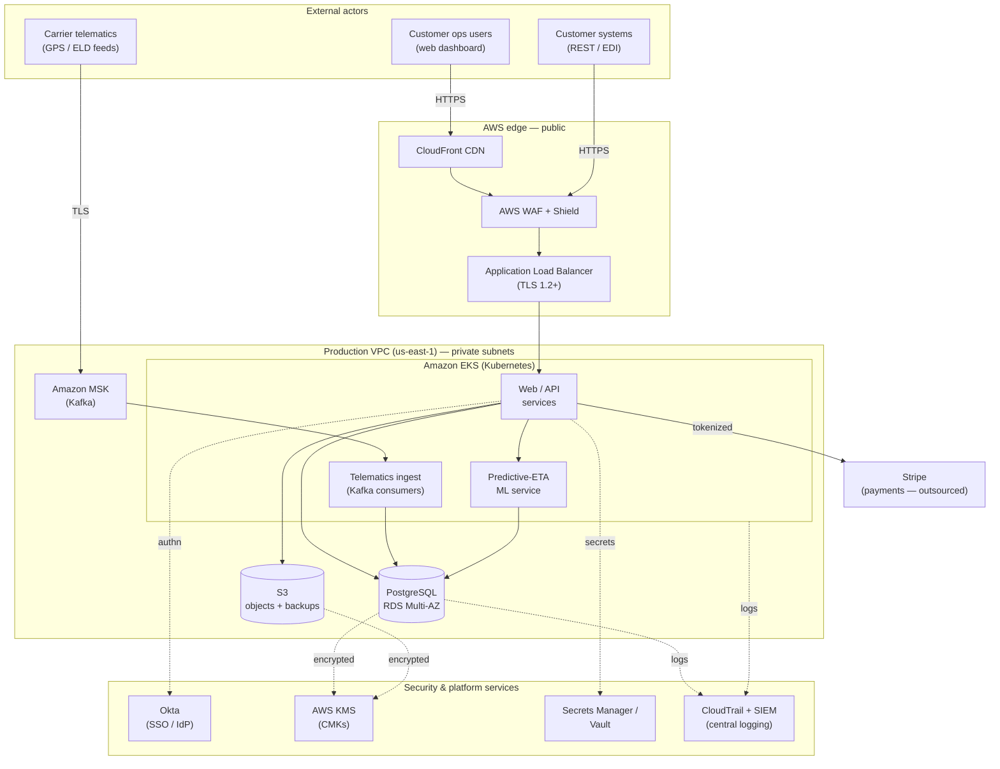
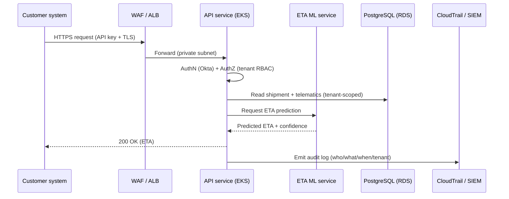

# System Profile — Sightline (Harborline Technologies, Inc.)

> **Synthetic data notice.** Harborline Technologies and Sightline are **fictional**.
> This profile is invented to anchor a realistic ISO/IEC 27001:2022 control
> assessment. Names, figures, and architecture are illustrative. The control
> framework referenced is real; see [`docs/methodology.md`](../docs/methodology.md).

---

## 1. Company at a glance

| Attribute | Value |
|---|---|
| Company | Harborline Technologies, Inc. (fictional) |
| Product | **Sightline** — real-time supply-chain visibility & predictive-ETA SaaS |
| Market | Mid-market third-party logistics (3PL), freight brokers, and shippers |
| Founded | 2021 |
| Headcount | ~40 FTE (≈25 engineering, incl. 1 part-time Security Lead / CISO function) |
| Headquarters | Austin, TX (single engineering office; remote-first workforce) |
| Hosting | Amazon Web Services — `us-east-1` (primary), `us-west-2` (DR) |
| Deployment model | Multi-tenant B2B SaaS (shared services, logical tenant isolation) |
| Business driver for cert | Enterprise & public-sector prospects require ISO 27001; a US public-sector prospect asked for a NIST 800-53 crosswalk |
| Certification target | ISO/IEC 27001:2022 — Stage 1 Jan 2027, Stage 2 Mar 2027 |

## 2. What Sightline does

Sightline ingests live shipment, telematics (GPS), and carrier data, normalizes it,
and gives logistics operators a real-time map of where freight is, plus a
machine-learning **predictive ETA** for each shipment. Customers integrate via REST
API and EDI feeds; their operations teams use the web dashboard.

The predictive-ETA model is an in-house ML service. Because it processes
personal data (driver identifiers and location), it is subject to a Data Protection
Impact Assessment (DPIA) and is a forward-looking driver for adopting **ISO/IEC
42001** (AI management) after 27001 certification.

## 3. Data types & sensitivity

| Data type | Examples | Classification | Notes |
|---|---|---|---|
| Customer account data | Company, users, roles, billing metadata | Confidential | Billing handled by Stripe (PCI outsourced — SAQ-A scope) |
| Contact PII | Shipper/consignee names, emails, phones | Confidential | Subject to GDPR/CCPA (EU + CA customers) |
| Driver PII | Driver name, ID/license ref, phone | Restricted | Minimized; used for dispatch + ETA |
| Location / telematics | GPS pings, routes, dwell times | Restricted | Can reveal individual movement patterns |
| Shipment metadata | Order refs, commodities, timestamps | Internal | Volume driver of the platform |
| Operational/audit logs | Auth, admin, API access logs | Confidential | 400-day retention, integrity-protected |
| Secrets / keys | API keys, DB creds, KMS keys | Restricted | Vault + AWS Secrets Manager / KMS |

**Out of scope for cardholder data:** Sightline does not store PAN; payment is
tokenized through Stripe. **Regulatory drivers:** GDPR, CCPA/CPRA, US state breach
laws; contractual security obligations from enterprise customers.

## 4. Architecture overview

### Trust boundaries
1. **Internet → AWS edge.** All ingress is HTTPS through CloudFront + WAF + Shield;
   TLS terminates at the ALB. No service is directly internet-exposed.
2. **Edge → Application (private subnets).** Compute runs in private subnets on EKS;
   security groups are deny-by-default; no public database endpoints.
3. **Application → Data.** RDS and S3 are encrypted at rest (AWS KMS CMKs); access is
   least-privilege via IAM roles for service accounts (IRSA).
4. **Corporate → Cloud (admin plane).** Human administrative access requires SSO +
   phishing-resistant MFA over ZTNA; there is no standing shared admin credential.
5. **Environment isolation.** Dev, test, and production run in **separate AWS
   accounts** with no shared credentials.

## 5. Data flow (predictive-ETA request)

## 6. AWS shared-responsibility summary

| Layer | Responsibility | Relevant Annex A controls |
|---|---|---|
| Physical data center, hardware, power, cooling | **AWS** (inherited) | A.7.5, A.7.11, A.7.12, A.7.13 |
| Hypervisor, managed-service patching (RDS, EKS control plane) | **AWS** (inherited) | A.8.8 (shared), A.8.19 |
| Guest OS / container images, app code, IAM, data, config | **Harborline** | A.8.x technological controls |
| Corporate office physical security | **Harborline** | A.7.1–A.7.4, A.7.7 |
| Identity, access, encryption keys, logging config | **Harborline** | A.5.15–A.5.18, A.8.5, A.8.15, A.8.24 |

This division is why several physical controls (A.7.6, A.7.10, A.7.11, A.7.12) are
scoped **Not Applicable** or inherited in the Statement of Applicability — see the
[workbook](../control_assessment_workbook.xlsx) and
[SSP section](../ssp/sample_ssp_section.md).

## 7. Personnel & suppliers (in ISMS scope)

- **People:** ~40 staff, remote-first; company-managed, MDM-enrolled laptops; all
  hires background-checked; annual security awareness training.
- **Key suppliers / sub-processors:** AWS (hosting), Okta (identity), Stripe
  (payments), Datadog/SIEM vendor (observability), a managed detection & response
  (MDR) provider (24/7 monitoring), Checkr (background checks), Google Workspace
  (email/productivity). Each is tracked in the third-party risk register.

## 8. Key security metrics / objectives (illustrative)

| Objective | Target | Current |
|---|---|---|
| RTO / RPO (production) | 4 h / 1 h | Defined; **DR failover not yet fully tested** (gap A.5.30) |
| Critical vuln remediation SLA | ≤ 7 days | ~65% within SLA (gap A.8.8) |
| MFA coverage (workforce) | 100% | 100% |
| Security awareness completion | ≥ 95% | 96% |
| Access recertification cadence | Quarterly | Irregular (gap A.5.18) |
