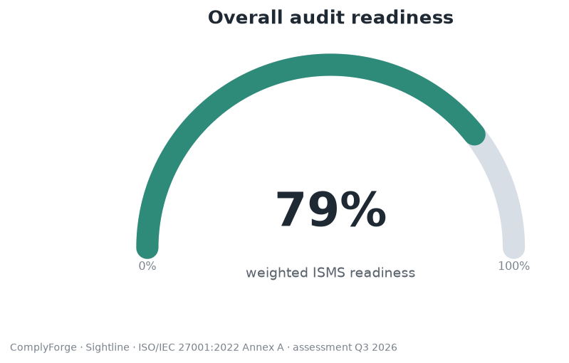
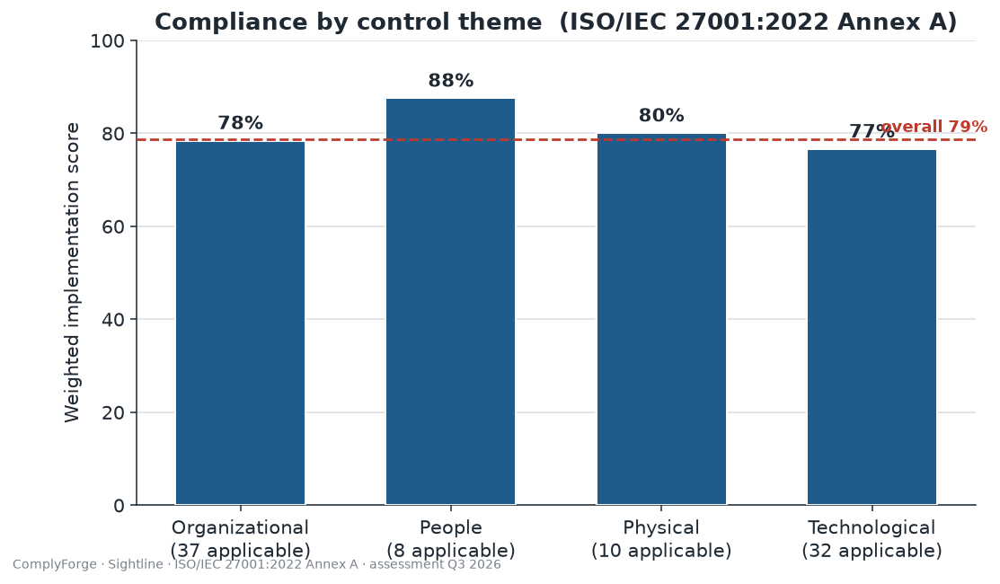
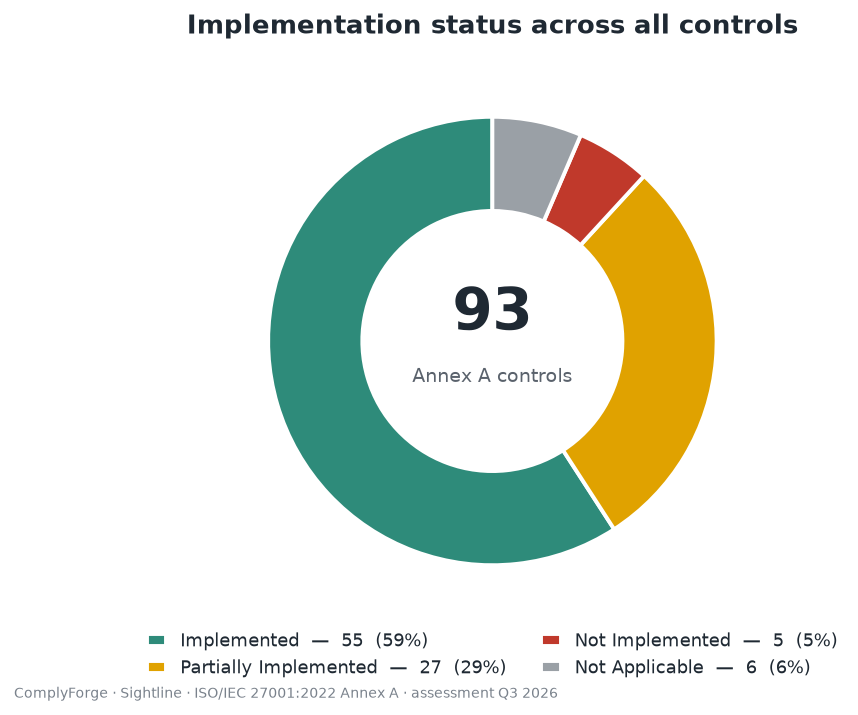
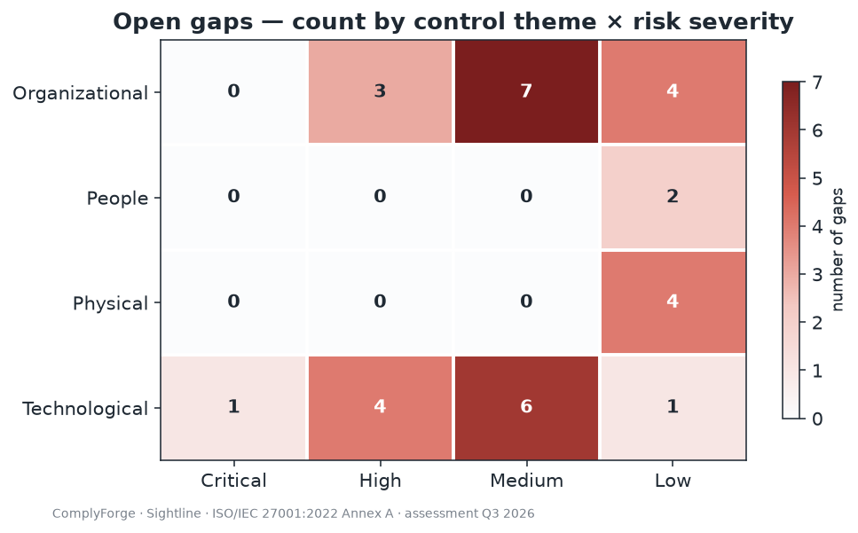
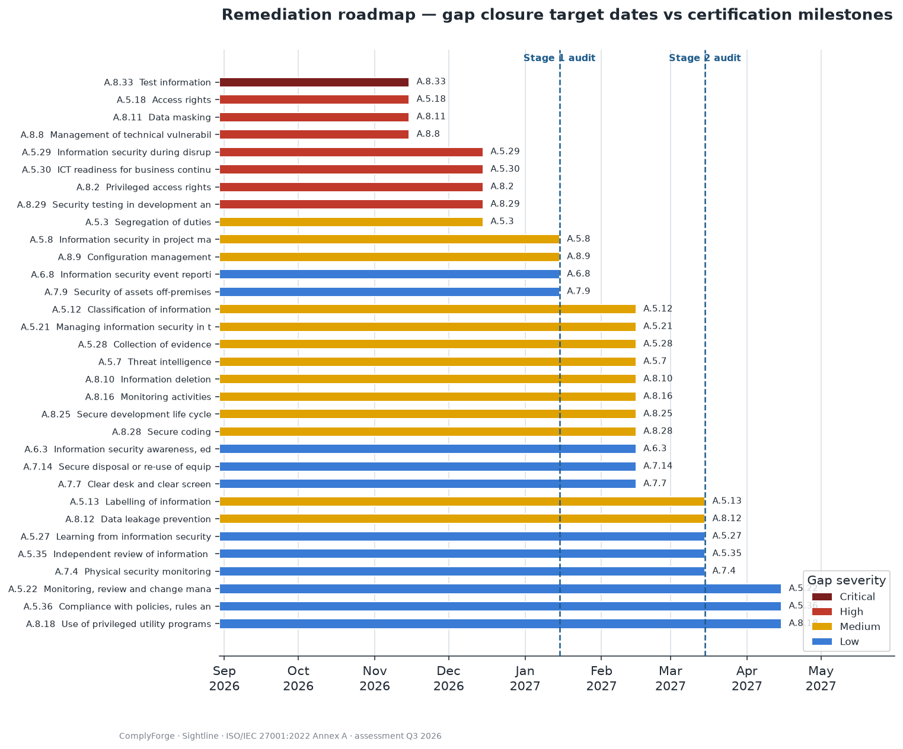

# Audit Readiness Report — Sightline

**Prepared for:** Security Steering Committee, Harborline Technologies, Inc.
**Prepared by:** Audit Lead (Security function)
**Assessment:** ISO/IEC 27001:2022 certification readiness · first-party assessment
**Date:** 30 August 2026 · **Assessment window:** Q3 2026

> **Fictional scenario.** Harborline and Sightline are invented for this portfolio
> artifact. The framework is real; the posture is synthetic. See
> [methodology](../docs/methodology.md).

---

## 1. Executive summary

Sightline is **on track but not yet ready** for ISO/IEC 27001:2022 certification. Of
93 Annex A controls, **87 are applicable**; the platform demonstrates a **78.7%
weighted compliance score**, with **55 controls fully implemented (63%)**, **27
partially implemented**, and **5 not implemented**. Six controls are Not Applicable
with documented justification.

The security foundations are strong: identity and access, encryption, logging,
backup, network segmentation, and change management are implemented and evidenced.
Readiness is held back by **32 open gaps**, concentrated in a few themes:
**privilege governance, vulnerability/patch SLAs, business-continuity testing, and
the use of real PII in non-production environments.**

**One gap is Critical and must be fixed first:** production customer PII is present in
staging/test without masking (A.8.33). Closing the **1 Critical + 7 High** gaps —
all scheduled before the January 2027 Stage 1 audit — would move the platform to a
defensible certification posture.

**Recommendation:** approve the remediation roadmap in §5, prioritize the eight
Critical/High items for Q4 2026, and schedule the Stage 1 audit for January 2027.

### Readiness at a glance

| Metric | Result |
|---|---|
| Applicable controls | 87 of 93 (6 Not Applicable) |
| Weighted compliance score | **78.7%** |
| Fully implemented | 55 (63% of applicable) |
| Partially implemented | 27 |
| Not implemented | 5 |
| Open gaps | 32 (**1 Critical, 7 High**, 13 Medium, 11 Low) |
| Certification target | Stage 1 Jan 2027 · Stage 2 Mar 2027 |

## 2. Compliance posture by control family

| Control theme | Applicable | Implemented | Partial | Not Impl. | Weighted score |
|---|---:|---:|---:|---:|---:|
| Organizational (A.5) | 37 | 23 | 12 | 2 | 78.4% |
| People (A.6) | 8 | 6 | 2 | 0 | 87.5% |
| Physical (A.7) | 10 | 6 | 4 | 0 | 80.0% |
| Technological (A.8) | 32 | 20 | 9 | 3 | 76.6% |
| **Overall** | **87** | **55** | **27** | **5** | **78.7%** |

**Reading it:** *People* is the strongest theme (mature HR-driven controls).
*Technological* scores lowest — not because core controls are missing, but because the
open gaps cluster in engineering practices (secure SDLC maturity, vulnerability
remediation, data handling in non-prod). *Organizational* is broad and mostly solid,
with governance gaps around reviews and continuity.

## 3. Gap analysis

The 32 open gaps distribute across themes and severities as shown above. Severity is a
function of likelihood × impact, weighting exposure of Restricted personal data most
heavily (see [methodology §4](../docs/methodology.md)).

### 3.1 Top gaps ranked by risk (the audit-blocking set)

| # | Control | Gap | Risk | Owner | Target |
|---:|---|---|---|---|---|
| 1 | **A.8.33** Test information | Production customer PII used to seed staging/test **without masking** — direct exposure of Restricted data in a lower-trust environment. | **Critical** | VP Engineering | Nov 2026 |
| 2 | **A.8.11** Data masking | No masking/pseudonymization in non-production; enables #1. | High | VP Engineering | Nov 2026 |
| 3 | **A.5.18** Access rights | No enforced quarterly access recertification; privileged/third-party access not reviewed within policy interval. | High | Platform/DevOps Lead | Nov 2026 |
| 4 | **A.8.8** Technical vulnerabilities | Remediation SLA missed for ~35% of findings; no single aged backlog. | High | Platform/DevOps Lead | Nov 2026 |
| 5 | **A.8.2** Privileged access | Standing production admin for 6 accounts; no JIT elevation or privileged-session logging. | High | Platform/DevOps Lead | Dec 2026 |
| 6 | **A.8.29** Security testing | No consistent DAST; no release security-acceptance gate; pentest findings not SLA-tracked. | High | VP Engineering | Dec 2026 |
| 7 | **A.5.29** Security during disruption | BCP unratified; security controls in degraded mode untested. | High | SRE Lead | Dec 2026 |
| 8 | **A.5.30** ICT readiness for BC | RTO/RPO defined but never validated by a full DR failover test. | High | SRE Lead | Dec 2026 |

Closing these eight removes the most likely sources of a **major nonconformity** at
audit. Items #1–#2 are the single most urgent thread: they should be treated as one
workstream (purge PII from non-prod, stand up masked/synthetic data, add pipeline
guardrails).

### 3.2 Themes behind the gaps

- **Data handling in non-production (Critical).** Real PII in staging is the clearest
  privacy/confidentiality exposure and the most reputationally damaging if breached.
- **Privilege governance (High).** Standing admin + irregular access reviews are
  classic audit findings; JIT + quarterly recertification resolve both.
- **Vulnerability & release assurance (High).** Scanning exists; the gap is
  *closure discipline* — SLA adherence, a single aged backlog, and a security gate.
- **Business continuity (High).** Architecture is resilient (Multi-AZ, cross-region
  backups); the gap is *proof* — a ratified BCP and a tested DR failover.

## 4. Strengths (evidence the platform is fundamentally sound)

- Phishing-resistant MFA and SSO everywhere; no standing shared admin credential.
- Encryption in transit (TLS 1.2+) and at rest (AES-256, KMS CMKs) with key rotation.
- Centralized, integrity-protected logging (CloudTrail + SIEM, S3 Object Lock, 400-day
  retention) with synchronized clocks.
- Automated, tested backups (RDS PITR, S3 cross-region) and Multi-AZ redundancy.
- Separate AWS accounts per environment; IaC change management via reviewed pull
  requests and CI/CD.
- Mature people controls: background checks, onboarding/offboarding automation, NDAs,
  96% awareness-training completion.

## 5. Remediation roadmap

**Sequencing principle:** fix the Critical and High gaps in Q4 2026 (before Stage 1),
then clear Medium items ahead of Stage 2, and burn down Low items continuously.

| Wave | Window | Focus | Gaps |
|---|---|---|---|
| **Wave 1 — Audit blockers** | Sep–Dec 2026 | Remove PII from non-prod, masking, access recertification, vuln-SLA discipline, JIT privilege, DR failover test, BCP ratification, security testing gate | 1 Critical + 7 High |
| **Wave 2 — Nonconformity risks** | Jan–Feb 2027 | Classification/labelling, secure-SDLC & secure-coding standards, config-drift detection, monitoring coverage, evidence-handling procedure, threat-intel process, tenant-deletion automation, DLP | 13 Medium |
| **Wave 3 — Continuous improvement** | Feb–May 2027 | Awareness role-based training, clear-desk audits, ITAD certificates, supplier re-review cadence, incident-trend analysis, privileged-utility logging, independent-review cadence | 11 Low |

**Milestones**
- **Dec 2026:** all Critical/High gaps closed; internal re-assessment.
- **Jan 2027:** ISO 27001 **Stage 1** (documentation/readiness) audit.
- **Feb 2027:** Medium gaps closed; management review.
- **Mar 2027:** ISO 27001 **Stage 2** (certification) audit.

## 6. Certification decision

**Go / conditional-go.** Proceed toward certification on the roadmap above. The
platform's control design is sound; the work is disciplined closure of operational
gaps and evidence collection. Contingent on **Wave 1 completion by end of Q4 2026**,
Sightline is positioned to pass Stage 2 in March 2027 with, at most, minor
nonconformities.

---

*Supporting artifacts:* [control assessment workbook](../control_assessment_workbook.xlsx)
· [evidence tracker](../evidence_tracker.xlsx)
· [sample SSP section](../ssp/sample_ssp_section.md)
· [system profile](../data/system_profile.md)
· [methodology](../docs/methodology.md)
