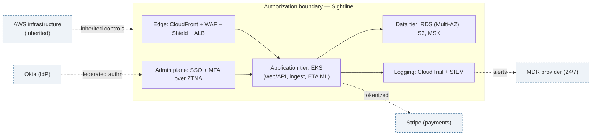

# System Security Plan (SSP) — Sightline (Sample Section)

**System:** Sightline SaaS Platform
**Operator:** Harborline Technologies, Inc. (fictional)
**Document status:** Sample / illustrative section · v0.9 · 30 Aug 2026
**Frameworks:** ISO/IEC 27001:2022 (primary) with NIST SP 800-53 Rev. 5 control
references; structured per NIST SP 800-18 / FedRAMP SSP conventions.

> This is a **representative SSP section**, not a full plan. It demonstrates system
> characterization plus properly written control-implementation narratives for two
> control families. All operational detail is **synthetic** (see
> [`../data/system_profile.md`](../data/system_profile.md)).

---

## 1. System identification

| Field | Value |
|---|---|
| System name | Sightline SaaS Platform |
| System acronym | SSP-CORE |
| System owner | CTO, Harborline Technologies, Inc. |
| Authorizing official (analog) | CEO / Security Steering Committee |
| System security officer | Security Lead (CISO function) |
| Service model | Software-as-a-Service (multi-tenant) |
| Deployment model | Public cloud (AWS) |
| Operational status | Operational (production) |
| Assessment date | 30 August 2026 |

## 2. Security categorization

Applying a FIPS 199–style impact analysis to the information types processed
(customer PII, driver PII, location/telematics, operational logs):

| Objective | Impact | Rationale |
|---|---|---|
| Confidentiality | **Moderate** | Restricted PII (driver identity + location) could harm individuals if disclosed; customer business data is commercially sensitive. |
| Integrity | **Moderate** | Corrupted shipment/ETA data degrades customer operations and trust, but is not life-safety critical. |
| Availability | **Moderate** | Customers depend on real-time visibility; extended outage has material business impact, mitigated by SLAs and DR. |

**Overall categorization: Moderate** (high-water mark). This maps to a NIST 800-53
Moderate baseline for the crosswalk and informs control rigor.

## 3. System description and purpose

Sightline provides real-time supply-chain visibility and machine-learning predictive
ETAs to mid-market logistics operators. It ingests shipment, carrier, and GPS
telematics data through REST APIs, EDI, and streaming feeds; normalizes and stores it;
computes predictive ETAs; and presents the results through a web dashboard and API.

The platform is a cloud-native, multi-tenant application on AWS. Tenants are logically
isolated at the application and data layers (row-level tenant scoping enforced and
tested). A predictive-ETA machine-learning service processes driver identifiers and
location data and is therefore covered by a Data Protection Impact Assessment.

## 4. Authorization boundary

The authorization boundary comprises the AWS production environment (`us-east-1`
primary, `us-west-2` disaster recovery), the CI/CD pipeline, the identity provider
integration, and the administrative access plane. Corporate endpoints used for
administration are included; the AWS physical infrastructure is **inherited** under
the shared-responsibility model and evidenced by AWS third-party attestations.

**Interconnections / external services:** Okta (identity, federated), Stripe
(payments, tokenized — no cardholder data enters the boundary), AWS managed services
(inherited), MDR provider (receives security telemetry). Each is governed by an
agreement with security terms (A.5.20) and tracked in the third-party risk register.

## 5. Information types and sensitivity

See [`../data/system_profile.md#3-data-types--sensitivity`](../data/system_profile.md)
for the full table. Summary: Restricted (driver PII, location, secrets), Confidential
(customer/contact PII, account and log data), Internal (shipment metadata). Data is
encrypted in transit (TLS 1.2+) and at rest (AES-256 via AWS KMS customer-managed
keys).

## 6. Roles and responsibilities (control ownership)

| Role | Security responsibilities |
|---|---|
| CTO / System Owner | Accountable for the system and its risk acceptance. |
| Security Lead (CISO fn) | Owns the ISMS, risk register, incident response, and this SSP. |
| Platform / DevOps Lead | Cloud security config, IAM, network, secrets, endpoints. |
| SRE Lead | Availability, backup/restore, logging, capacity, DR. |
| Data Protection Officer | Privacy, data classification, DSARs, retention. |
| VP Engineering | Secure SDLC, source-code access, secure coding, testing. |
| People Operations | Screening, onboarding/offboarding, awareness training. |
| Legal & Compliance | Supplier agreements, legal/regulatory register, NDAs. |

---

## 7. Control implementation narratives

The following two families are written up in full. Status labels align to the
[control workbook](../control_assessment_workbook.xlsx). NIST 800-53 references are
provided for the crosswalk.

### 7.1 Access control & identity (A.5.15–A.5.18, A.8.2–A.8.5 · NIST AC / IA)

**Policy and model — Implemented (A.5.15 / AC-1).**
An approved Access Control Policy (v2.2) establishes role-based access control (RBAC)
and least-privilege, deny-by-default principles across the platform and corporate
systems. Access to information and functions is granted on the basis of documented
roles.

**Identity lifecycle — Implemented (A.5.16 / IA-4, AC-2).**
Okta is the identity provider. Joiner-mover-leaver events are automated via SCIM:
provisioning on hire, role changes on transfer, and same-day deprovisioning on
termination (verified against the HRIS offboarding checklist). Each human user has a
unique identifier; service accounts are inventoried and mapped to owners.

**Authentication information — Implemented (A.5.17 / IA-5).**
Password policy is enforced centrally in Okta and aligns to NIST 800-63 guidance.
Application and infrastructure secrets are stored in AWS Secrets Manager and HashiCorp
Vault; no credentials are hard-coded (enforced by `gitleaks` in CI). KMS customer-
managed keys are rotated.

**Secure authentication — Implemented (A.8.5 / IA-2).**
Single sign-on is used across systems. Administrators authenticate with phishing-
resistant MFA (WebAuthn/FIDO2); end users use TOTP MFA. Brute-force lockout and
session controls are enforced. There is no standing shared administrator credential.

**Information access restriction — Implemented (A.8.3 / AC-3, AC-6).**
The application enforces RBAC and **row-level tenant isolation**; cross-tenant access
is denied by default, and isolation is covered by automated tests. Data access follows
least privilege.

**Source-code access — Implemented (A.8.4 / CM-5).**
GitHub is integrated with SSO/SAML. Repositories use branch protection, CODEOWNERS,
and least-privilege roles; direct commits to `main` are prohibited.

**Privileged access — Partially Implemented (A.8.2 / AC-6 · GAP, High).**
Administrative access to AWS uses SSO roles with MFA, and production changes require
approval. **However**, six accounts retain *standing* privileged access, and there is
no just-in-time (JIT) elevation or session logging for the database break-glass path.
*Remediation:* adopt JIT elevation via AWS IAM Identity Center with approval, remove
standing admin, and enable privileged-session logging. *Owner:* Platform/DevOps Lead.
*Target:* Dec 2026.

**Access review — Partially Implemented (A.5.18 / AC-2(3) · GAP, High).**
Provisioning and deprovisioning are automated, but periodic access **recertification**
is irregular (last full review nine months ago). *Remediation:* quarterly access-
recertification campaigns starting with privileged and production access. *Owner:*
Platform/DevOps Lead. *Target:* Nov 2026.

> **Family assessment:** Access control is a relative strength (strong preventive
> controls) with two operational gaps in *privilege governance* and *review cadence*.
> Both are scheduled to close before the Stage 1 audit.

### 7.2 Logging, monitoring & audit accountability (A.8.15–A.8.17, A.5.25 · NIST AU / SI)

**Logging — Implemented (A.8.15 / AU-2, AU-3, AU-9).**
CloudTrail is enabled in all AWS accounts; VPC flow logs and application/audit logs
are centralized in a SIEM. Logs capture identity, action, timestamp, source, and
tenant context. Integrity is protected using S3 Object Lock (write-once), and logs are
retained for 400 days.

**Clock synchronization — Implemented (A.8.17 / AU-8).**
All hosts synchronize to the Amazon Time Sync Service (NTP); log timestamps are
recorded in UTC and verified for consistency, ensuring reliable event correlation.

**Event assessment — Implemented (A.5.25 / IR-4, IR-5, AU-6).**
A documented triage runbook and severity-classification criteria route security
events from the SIEM and PagerDuty to the on-call responder for assessment and
incident decisioning.

**Monitoring — Partially Implemented (A.8.16 / SI-4 · GAP, Medium).**
A managed detection & response (MDR) provider monitors infrastructure and endpoint
telemetry 24/7. **However**, application-layer security monitoring (business-logic
abuse, tenant-boundary anomalies, authorization anomalies) has coverage gaps; alerting
is tuned mainly to infrastructure and endpoints. *Remediation:* add application-layer
detections and tenant-isolation anomaly alerts to the SIEM, defined by a use-case
coverage matrix. *Owner:* Security Lead. *Target:* Feb 2027.

> **Family assessment:** Foundational logging and audit accountability are strong and
> well-evidenced. The residual gap is *detection coverage* at the application layer,
> not log generation or retention.

---

## 8. Summary of this section's control posture

| Control | Family | Status | Risk |
|---|---|---|---|
| A.5.15 Access control | Access | Implemented | — |
| A.5.16 Identity management | Access | Implemented | — |
| A.5.17 Authentication information | Access | Implemented | — |
| A.5.18 Access rights | Access | Partially Implemented | High |
| A.8.2 Privileged access rights | Access | Partially Implemented | High |
| A.8.3 Information access restriction | Access | Implemented | — |
| A.8.4 Access to source code | Access | Implemented | — |
| A.8.5 Secure authentication | Access | Implemented | — |
| A.8.15 Logging | Audit | Implemented | — |
| A.8.16 Monitoring activities | Audit | Partially Implemented | Medium |
| A.8.17 Clock synchronization | Audit | Implemented | — |
| A.5.25 Assessment of events | Audit | Implemented | — |

The full 93-control assessment, Statement of Applicability, gap register, and
remediation roadmap are in
[`../control_assessment_workbook.xlsx`](../control_assessment_workbook.xlsx) and the
[audit readiness report](../reports/audit_readiness_report.md).
